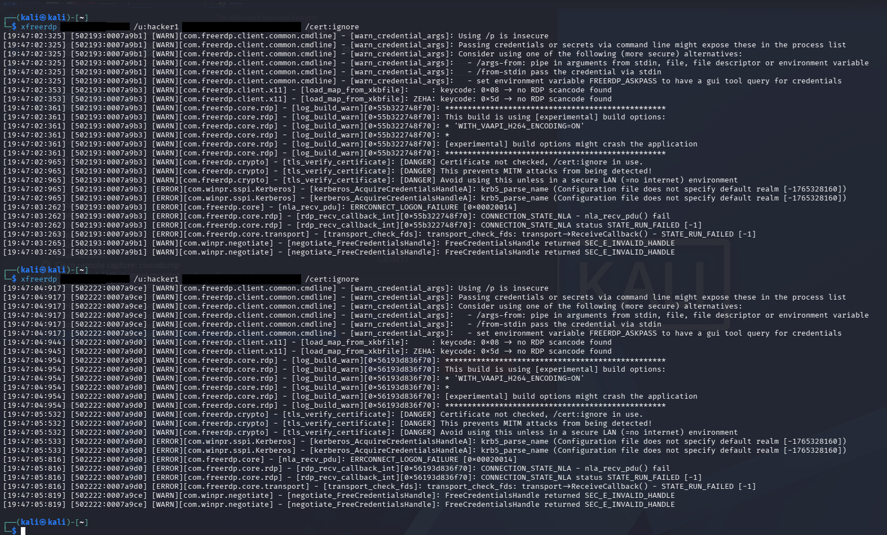
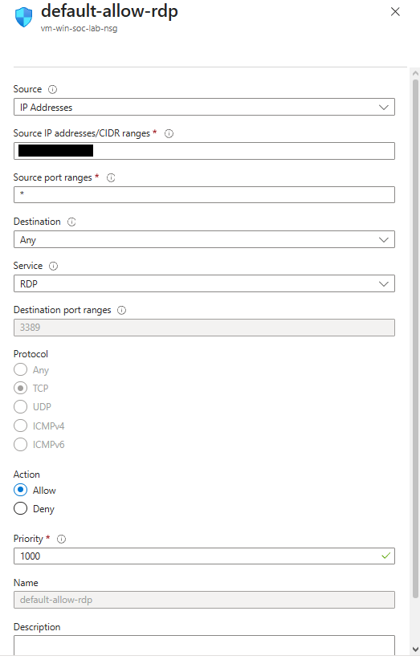
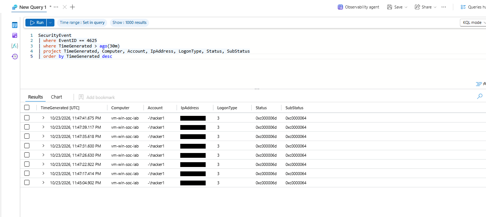
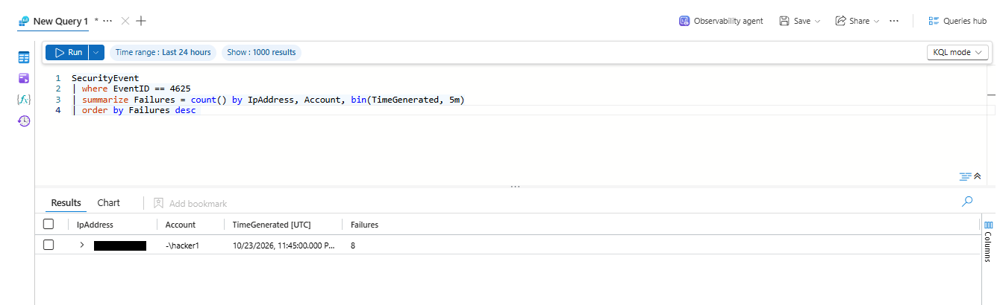
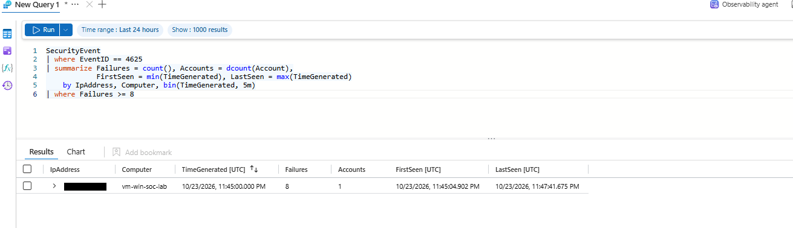
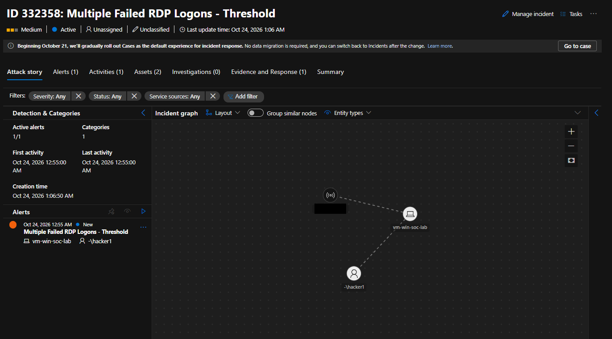
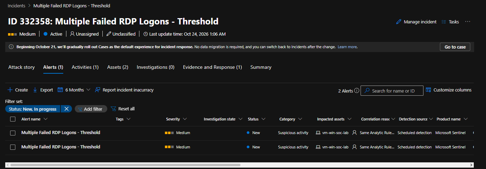
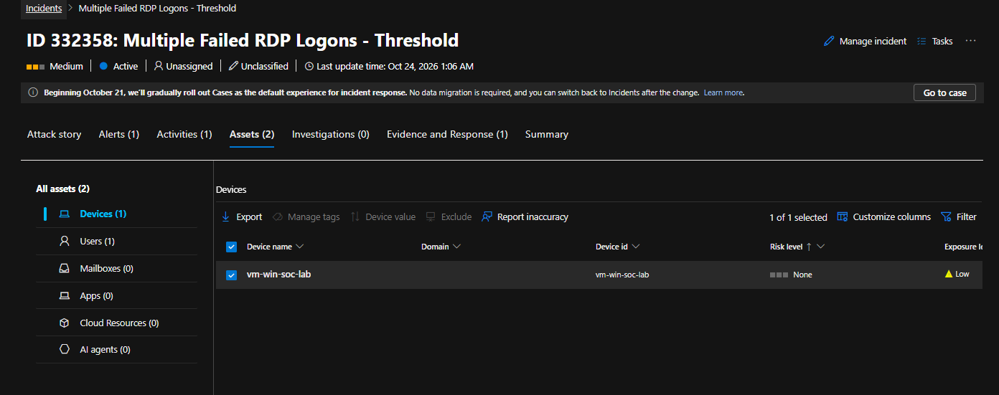
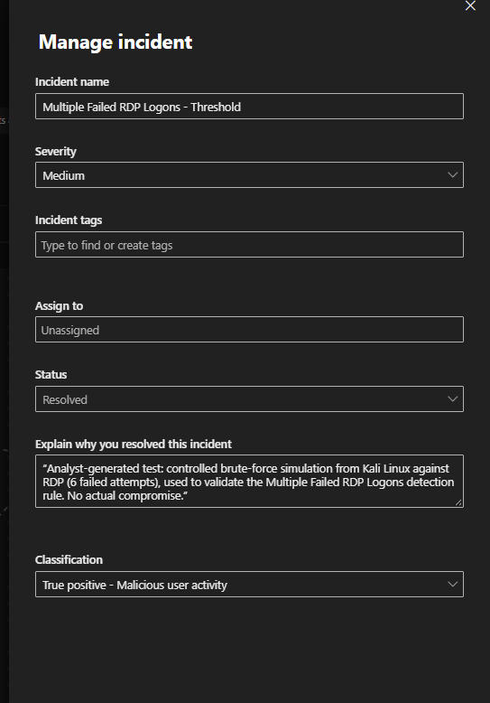

## SOC Alert Triage Report

> Standardized template for the initial triage, investigation, classification, and escalation of security alerts.

---

## 1. Case Information

| Field | Value |
|---|---|
| **Alert ID** | BL-ALT-2026-002 |
| **Alert Name** | Multiple Failed RDP Logons - Threshold |
| **Origin** | Lab-generated: controlled brute-force simulation, not a production alert |
| **Analyst** | Andy Vega |
| **Date Opened** | 2026-10-23 |
| **Detection Time** | 2026-10-23 23:45:04 UTC (first burst); 2026-10-24 (second burst, see Section 13) |
| **Detection Source** | Microsoft Sentinel Scheduled Analytics Rule, built on Azure Monitor Agent → `SecurityEvent` |
| **Severity** | Medium (as fired by the rule) |
| **Priority** | P4 |
| **Status** | Resolved (Sentinel classification: Informational, expected activity — Security testing) |

---

## 2. Alert Summary

### Description

A simulated password-guessing attack was run from a Kali Linux VM against the RDP service of `vm-win-soc-lab` (Azure), using the non-existent local account `hacker1`. Eight connection attempts were made with `xfreerdp` in two sub-bursts, about 2.5 minutes apart, all using an intentionally incorrect credential. All eight were rejected by Windows and logged as Event ID 4625.


*EV-002 — Kali terminal, two bursts of failed `xfreerdp` connection attempts.*

A custom Sentinel Analytics Rule, built specifically for this test, aggregates 4625 events in 5-minute windows and fires when 5 or more failures come from the same source in that window. The rule correctly detected the burst and Sentinel created incident `ID 332358`, correlating the source IP, the target host and the account name into a single graph.


*EV-001 — NSG rule `default-allow-rdp`, restricting RDP to the Kali VM's public IP only.*

### Detection Logic

```text
SecurityEvent
| where EventID == 4625
| summarize Failures = count(),
            FirstSeen = min(TimeGenerated),
            LastSeen = max(TimeGenerated)
    by IpAddress, Computer, Account, bin(TimeGenerated, 5m)
| where Failures >= 5
```

Scheduled every 5 minutes, looking back 15 minutes, alert threshold "greater than 0 results". See Section 13 for the configuration mistakes found and corrected while building this rule.


*EV-003 — Raw query result: the 8 Event ID 4625 failures.*


*EV-004 — The same burst, grouped by 5-minute window, before any threshold.*


*EV-005 — An earlier, stricter threshold (>= 8) tested before settling on 5.*

### Initial Context

This case was built to close the biggest gap identified in the portfolio review: no SIEM-based detection existed yet. Unlike case [`BL-ALT-2026-001`](../BL-ALT-2026-001/triage.md) (a single local PIN mistake with no useful IP or account name), this case simulates a network-based brute-force attempt with a real external source IP and an account name captured end-to-end, so the full Sentinel entity-mapping and incident-graph workflow could be exercised.


*EV-007 — Incident `332358` investigation graph: source IP → host → account.*

---

## 3. Affected Entities

| Entity Type | Value | Context |
|---|---|---|
| Hostname | `vm-win-soc-lab` | Azure Windows Server 2025 Datacenter VM |
| Username | `hacker1` (local, non-existent) | Intentionally invented account name; never provisioned on the VM (see Section 5) |
| Source IP | `[redacted]` (public IP of the Kali VM) | Allowed through the NSG rule `default-allow-rdp`, which restricts RDP to this single `/32` |
| Destination IP | `[redacted]` (public IP of `vm-win-soc-lab`) | Azure VM public IP |
| Domain | Not applicable | Local account logon, no Active Directory |
| Process | RDP service (`TermService`) on the target; `xfreerdp` on the source | |

---

## 4. Initial Evidence

| Timestamp (UTC) | Source | Event / Observation |
|---|---|---|
| 2026-10-23 23:45:04.902 – 23:47:41.675 | Windows Security log (via Sentinel) | 8x Event ID 4625, `Computer=vm-win-soc-lab`, `Account=-\hacker1`, `LogonType=3`, `Status=0xC000006D`, `SubStatus=0xC0000064` |
| 2026-10-24 (second burst) | Windows Security log (via Sentinel) | A second burst of 5 failures was also captured by the rule and grouped into the same incident as a second alert (see Section 8, "Alerts (2)") |
| 2026-10-24 01:06:50 | Microsoft Sentinel | Incident `ID 332358` created, severity Medium, status Active |

### Evidence Sources

- [ ] SIEM (Sentinel is the detection platform itself, not a separate correlated source)
- [ ] EDR
- [x] Windows Event Logs
- [x] Microsoft Sentinel (Analytics Rule, Incident, Investigation graph)
- [ ] Sysmon
- [ ] Firewall
- [x] Authentication logs
- [ ] PCAP
- [ ] Email headers
- [ ] Threat Intelligence
- [ ] Other

---

## 5. Triage Questions

### Is the activity expected?

**Answer:** Yes.

**Evidence:** The analyst generated the attempts from a known Kali VM, at a known source IP, against an account name chosen specifically for this test. The timing of the Sentinel incident (creation time 01:06:50, first/last activity 00:55:00) aligns with when the test was run.

---

### Does the activity present a security risk?

**Answer:** No, in this instance, but the pattern is one a real attacker would also produce.

**Evidence:** `SubStatus 0xC0000064` means **the account does not exist** (`STATUS_NO_SUCH_USER`), not a wrong password on a real account. `hacker1` was never created on `vm-win-soc-lab`. This means the attempts could not have succeeded regardless of how many were tried, and no valid credential was ever at risk. A real attacker guessing against an unknown account name would produce the same signature; the detection does not depend on the account being real.

---

### Are additional users, hosts, or systems involved?

**Answer:** No. All 8 failures (plus the second burst) map to the same source IP, the same target host and the same account name.

---

### Is there evidence of compromise?

**Answer:** No. Every attempt failed at the credential stage; no session was established with the `hacker1` identity, and no other suspicious activity (process creation, privilege use) was correlated to it in the Assets/Alerts review.

---

### Is immediate containment required?

**Answer:** No. The activity is explained, self-generated, and the NSG already restricts RDP to a single known source address, which limited the blast radius of this test by design.

---

## 6. Indicators & Artifacts

| Type | Value | Reputation / Status | Context |
|---|---|---|---|
| IP Address | `[redacted]` (Kali VM public IP) | Known, analyst-controlled | Source of all 8 failures; matches the NSG's allowed `/32` |
| IP Address | `[redacted]` (target VM public IP) | Known, analyst-owned | `vm-win-soc-lab` |
| User Account | `hacker1` | Non-existent, analyst-chosen | Never provisioned; `STATUS_NO_SUCH_USER` confirms this |
| Process | `xfreerdp` (source) | Legitimate open-source RDP client | Used as the test tool, not malware |

---

## 7. Threat Intelligence Enrichment

Not performed. Both IP addresses are known lab infrastructure (the analyst's own Kali VM and the analyst's own Azure VM), so a reputation lookup would add nothing.

---

## 8. Analyst Assessment

### Disposition

- [ ] True Positive — Malicious
- [x] True Positive — Detection validation (simulated attack, correctly detected)
- [ ] Benign Positive
- [ ] False Positive
- [ ] Inconclusive

> Sentinel's own classification taxonomy maps this case to **"Informational, expected activity" → "Security testing"**, which is the label applied when the incident was closed. This matches the finding recorded here: a real pattern, correctly detected, generated on purpose as a test.

### Analyst Confidence

- [x] High


*EV-008 — The incident's `Alerts` tab, showing 2 alerts grouped into 1 incident.*


*EV-009 — The incident's `Assets` tab.*

### Assessment

**Observed facts:**

- 8 Event ID 4625 failures in roughly 2.5 minutes, split into two sub-bursts, all `LogonType 3` (network), all `SubStatus 0xC0000064` (no such user), all from the same source IP against the same account name.
- The custom Analytics Rule's 5-failures-per-5-minutes threshold fired on this pattern, with correct entity mapping (IP, host, account) visible in the incident graph.
- A second, separate burst of 5 failures the following period was correlated into the **same** incident as a second alert, demonstrating Sentinel's alert-grouping behavior rather than creating a duplicate incident.

**Conclusion:**

The rule correctly identified a real brute-force pattern. Because the analyst generated and controlled every attempt, and because the account `hacker1` was never valid, there was no actual risk to any credential. This is the kind of result a detection-engineering exercise is meant to produce: proof the rule fires on the behavior it targets, not proof an attack happened. It is recorded here as a detection validation rather than a true incident response case.

---

## 9. MITRE ATT&CK Mapping

| Tactic | Technique | Technique ID | Supporting Evidence |
|---|---|---|---|
| Credential Access | Brute Force: Password Guessing | T1110.001 | 8 failed logons against a single account name from a single source in a short window |

> Note: because the target account never existed, this is closer to guessing a username/password pair than to exhausting a known account's password space. It is still recorded under T1110.001, since the observable behavior (rapid repeated authentication attempts) is identical from a detection standpoint; the account's non-existence is a property of this specific test, not of the technique.

---

## 10. Scope Assessment

### Confirmed Affected Assets

- `vm-win-soc-lab` (target of the simulated attack; no impact — all attempts rejected)

### Potentially Affected Assets

- None

### Additional Investigation Required

- None for this alert. A useful follow-up (not yet done) would be a second rule variant that also fires on a *valid* account receiving repeated failures with `SubStatus 0xC000006A` (wrong password, correct username), to see whether the same threshold behaves differently against a real identity.

---

## 11. Recommended Actions

### Immediate

- [x] No action required
- [x] Preserve evidence

### Action Details

Evidence preserved in `evidence/` (screenshots with source/destination IPs and the test password redacted, plus CSV transcriptions of the two KQL result sets).

### Longer-term (for the lab)

- Build the "valid account, wrong password" variant described in Section 10.
- Consider adding a NRT (near-real-time) rule for this detection if sub-5-minute latency becomes important to demonstrate.
- Document the NSG + "Kali and the browser share one public IP" design decision in the lab's main README, since it is the reason this test could run without exposing RDP publicly.

---

## 12. Escalation Decision

| Field | Value |
|---|---|
| **Escalation Required** | No |
| **Reason** | Detection validation: known, self-generated activity confirming a working rule, not a security incident |

---

## 13. Analyst Notes

```text
Analyst notes:

- Building this rule took several iterations, and each failure was itself useful to document:

  1. First version of the query used `Accounts = dcount(Account)` instead of keeping `Account`
     as a group-by column. This left no real account name in the query output, so Entity
     Mapping had nothing but a count to map the "Account" entity to. Fixed by rewriting the
     query to group by `Account` directly.
  2. Query scheduling was initially left at "Run query every 5 HOURS" / "Last 5 hours data"
     (Azure's wizard defaults to hours, not minutes, in one of the dropdowns, which is easy to
     miss). The rule technically worked but could take hours to notice anything. Fixed to
     5 minutes / 15 minutes lookback.
  3. Rule health monitoring ("Health monitoring") was never enabled for this rule, so that
     panel could not be used to check run history; `SecurityAlert` and `SentinelHealth` queries
     were used instead to confirm whether the rule had actually produced any alert.
  4. After both fixes, a second test burst was generated and the incident appeared within
     the expected window, confirming the fix.

- SubStatus 0xC0000064 ("no such user") was unexpected at first glance — the goal was a
  generic "brute force" case, and this result actually makes the case more interesting: it
  shows that this specific detection does not require the attacker to know a valid username.

- Incident closure in the Sentinel portal went through two classification attempts. The
  first, "False positive - Not malicious", was wrong: the detection logic was correct and the
  activity really was a brute-force pattern, so calling it a false positive misrepresents the
  rule's performance. The second, "True positive - Malicious user activity", was also not
  accurate, since the intent behind the activity was not malicious. The portal's taxonomy
  turned out to have a better fit under a separate top-level category,
  "Informational, expected activity" -> "Security testing", which is what the incident is
  closed under. This matches the framing used in Section 8 of this report.

- The tenant this Sentinel workspace is connected to also showed Defender XDR incidents
  involving other university accounts, unrelated to this lab. Those were not reviewed,
  documented, or captured in any evidence for this case.
```

---

## 14. Closure

| Field | Value |
|---|---|
| **Final Status** | Closed |
| **Final Disposition** | True Positive — detection validation (lab-generated). Sentinel classification: Informational, expected activity → Security testing |
| **Closure Time** | 2026-10-24 |
| **Resolution** | No action required. Rule validated after two configuration fixes; see Section 13 |


*EV-010 — Incident closure, classified as Informational, expected activity → Security testing.*

### Closure Summary

A simulated RDP brute-force attack (8 failed logons against a non-existent account, from a known source) was correctly detected by a custom Sentinel Analytics Rule after two configuration issues (query grouping and scheduling units) were found and fixed. The resulting incident correctly mapped the source IP, target host and account name into a single investigation graph, and a later second burst was correctly grouped into the same incident. No actual compromise occurred. This case is recorded primarily as a **detection engineering exercise**: it validates that the rule and its entity mapping work end-to-end, not as a response to a real threat.

---

## 15. Evidence References

| Evidence ID | Description | Location |
|---|---|---|
| EV-001 | NSG rule `default-allow-rdp`, restricting RDP to one source `/32` | `evidence/01_nsg_rdp_rule.png` |
| EV-002 | Kali `xfreerdp` terminal, two failed-connection bursts | `evidence/02_kali_rdp_attempts.png` |
| EV-003 | Raw `SecurityEvent` query: 8x Event ID 4625 | `evidence/03_4625_raw_events.png`, `evidence/EV-003_4625_events.csv` |
| EV-004 | Grouped query (no threshold) confirming the 8-failure burst | `evidence/04_grouped_no_threshold.png` |
| EV-005 | Threshold query (`Failures >= 8`), an earlier, stricter threshold tested before settling on 5 | `evidence/05_threshold_test_8.png` |
| EV-006 | Analytics Rule wizard showing the pre-fix configuration (`Accounts = dcount(Account)` mapping) | `evidence/06_rule_wizard_before_fix.png` |
| EV-007 | Incident `332358` investigation graph: IP → Host → Account | `evidence/07_incident_graph.png` |
| EV-008 | Incident "Alerts" tab showing 2 alerts grouped into 1 incident | `evidence/08_incident_alerts_tab.png` |
| EV-009 | Incident "Assets" tab, host risk/exposure | `evidence/09_incident_assets_tab.png` |
| EV-010 | Incident closure screen (classification: Informational, expected activity → Security testing) | `evidence/10_incident_closure.png` |
| EV-011 | Incidents list, single row for this incident | `evidence/11_incidents_list_row.png` |
| EV-012 | Threshold summary (CSV transcription of EV-004/EV-005 data) | `evidence/EV-004_threshold_summary.csv` |

---

# Document Control

| Field | Value |
|---|---|
| **Framework** | Blacklight Incident Response Framework |
| **Template** | SOC Alert Triage |
| **Version** | 1.0 |
| **Environment** | Cybersecurity Training / Portfolio Lab |
| **Classification** | Public |
