## SOC Alert Triage Report

> Standardized template for the initial triage, investigation, classification, and response of security alerts.

---

## 1. Case Information

| Field | Value |
|---|---|
| **Alert ID** | BL-ALT-2026-003 |
| **Sentinel Incident ID** | 340509 |
| **Alert Name** | Repeated CMD Process Creation - Threshold |
| **Origin** | Lab-generated: controlled Windows batch-script execution, not a production alert |
| **Analyst** | Andy Vega |
| **Date Opened** | 2026-11-08 |
| **Detection Time** | Activity detected at 2026-11-08 08:11 UTC; Sentinel incident created at approximately 08:19 UTC |
| **Detection Source** | Microsoft Sentinel Scheduled Analytics Rule, built on Azure Monitor Agent → `SecurityEvent` |
| **Severity** | Medium |
| **Priority** | P4 |
| **Status** | Resolved |
| **Portal Disposition** | Benign Positive; alert classified as Informational, expected activity — Security testing |

---

## 2. Alert Summary

### Description

A controlled batch script was executed on `vm-win-soc-lab` to generate repeated Windows Command Shell activity. The script recursively launched additional copies of itself through `cmd.exe`, creating a short burst of process-creation events.

Before the simulation, Windows Process Creation auditing and command-line logging were enabled. Windows Security Event ID 4688 was generated locally and successfully ingested into Microsoft Sentinel.

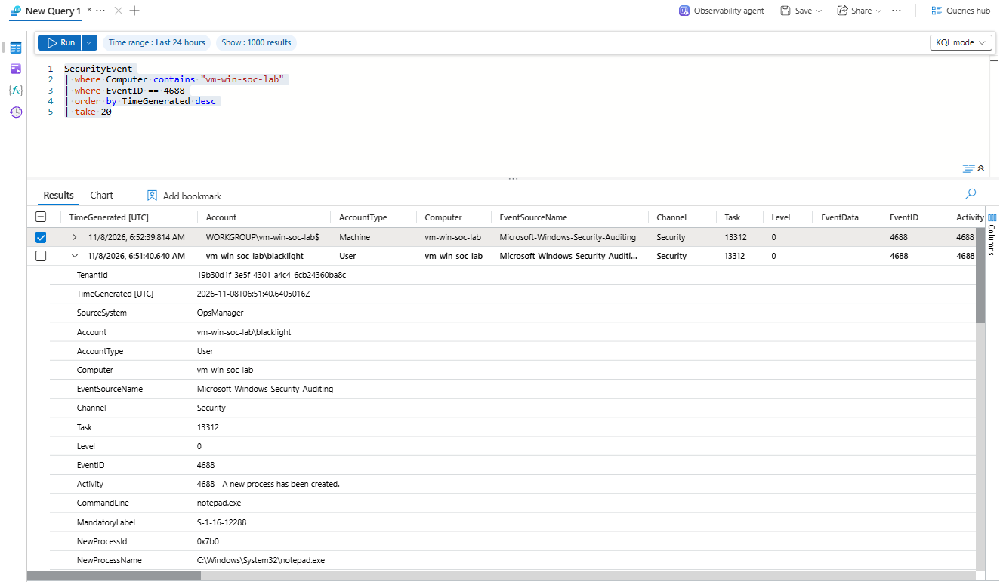
*EV-004 — Event ID 4688 from `vm-win-soc-lab` visible in Microsoft Sentinel.*

A baseline query showed that normal command-shell activity was generally low, while the first controlled simulation produced peaks of 48 and 23 `cmd.exe` executions per minute.

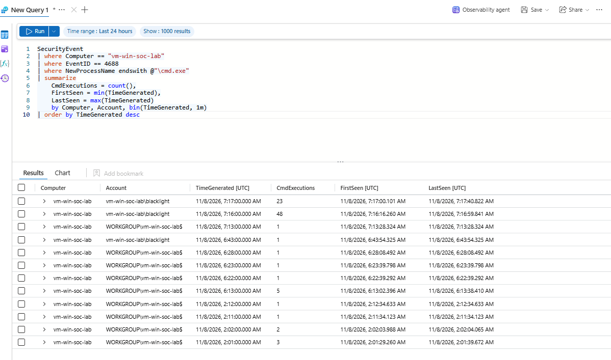
*EV-007 — Baseline and simulation activity used to tune the initial threshold.*

A threshold of 10 `cmd.exe` executions per minute was selected for this lab. During rule validation, a later controlled run generated 32 executions in one minute and matched the detection logic.

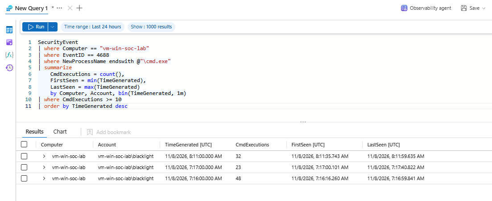
*EV-014 — Validation run returning 32 `cmd.exe` executions in one minute.*

Microsoft Sentinel generated a Medium-severity alert and created incident `340509`, mapping the affected host and account into the incident graph.

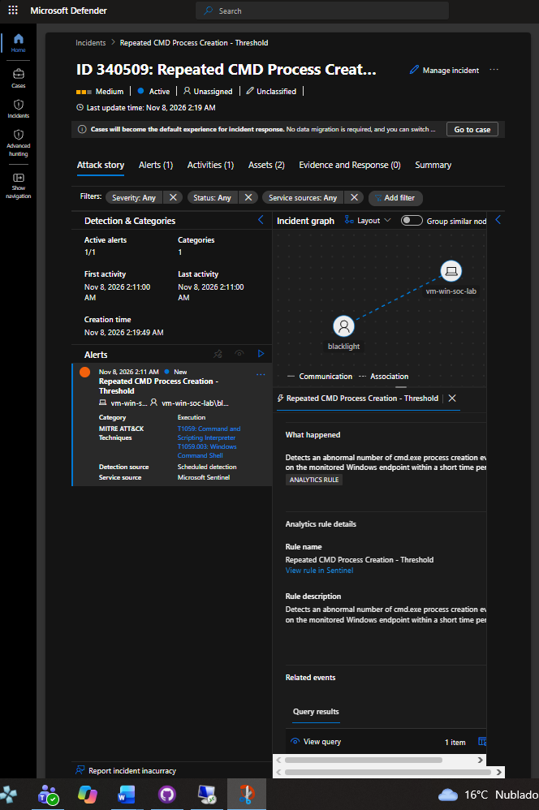
*EV-015 — Incident `340509`, showing the host and account entities.*

### Detection Logic

The query is also stored in [`detection.kql`](./detection.kql).

```text
SecurityEvent
| where Computer == "vm-win-soc-lab"
| where EventID == 4688
| where NewProcessName endswith @"\cmd.exe"
| summarize
    CmdExecutions = count(),
    FirstSeen = min(TimeGenerated),
    LastSeen = max(TimeGenerated)
    by Computer, Account, bin(TimeGenerated, 1m)
| where CmdExecutions >= 10
```

The Scheduled Analytics Rule was configured to run every 5 minutes and look back over the previous 5 minutes. The query itself contains the process-count threshold, so Sentinel generates an alert when the query returns one or more rows.

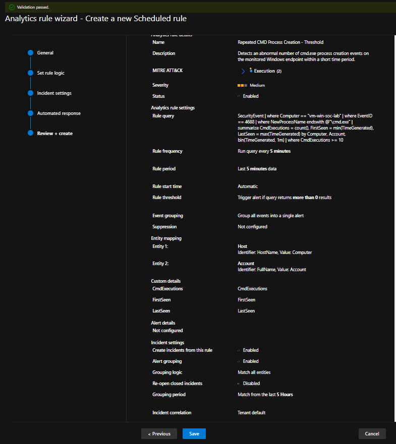
*EV-013 — Final Analytics Rule configuration after validation.*

### Initial Context

This case extends the lab beyond authentication monitoring. The previous RDP case focused on failed logons; this case focuses on endpoint process behavior, command-line telemetry, process relationships, containment, and application control.

The threshold used here is a lab-specific detection value based on observed behavior in this VM. It is not intended to be a universal production threshold.

---

## 3. Affected Entities

| Entity Type | Value | Context |
|---|---|---|
| Hostname | `vm-win-soc-lab` | Azure Windows Server endpoint monitored by Microsoft Sentinel |
| Username | `vm-win-soc-lab\blacklight` | Analyst-controlled local account used for the authorized test |
| Process | `cmd.exe` | Primary process detected by the Analytics Rule |
| Parent Process | `explorer.exe` / `cmd.exe` | Initial CMD launched from Explorer; subsequent CMD instances spawned by CMD |
| Related Process | `conhost.exe` | Expected Windows Console Host process associated with CMD sessions |
| Script | `Virus1.bat` | Controlled lab artifact used to generate repeated command-shell execution |
| Mitigation Control | AppLocker | File Hash Deny rule applied to the lab script |

---

## 4. Initial Evidence

| Timestamp / Period | Source | Event / Observation |
|---|---|---|
| 2026-11-08 | Local Security Policy | Process Creation auditing enabled with successful events |
| 2026-11-08 | Local Group Policy | Command-line data enabled for Process Creation events |
| 2026-11-08 06:51 UTC | Windows Security log | Event ID 4688 generated for a controlled `cmd.exe → notepad.exe` test |
| 2026-11-08 | Microsoft Sentinel | Event ID 4688 successfully ingested from `vm-win-soc-lab` |
| 2026-11-08 07:16–07:17 UTC | Microsoft Sentinel | Initial simulation produced peaks of 48 and 23 `cmd.exe` executions per minute |
| 2026-11-08 08:11 UTC | Microsoft Sentinel | Detection-validation run produced 32 `cmd.exe` executions in one minute |
| ~2026-11-08 08:19 UTC | Microsoft Sentinel / Defender | Incident `340509` created, severity Medium |
| 2026-11-08 09:12 UTC | AppLocker | Event ID 8007 confirmed `Virus1.bat` was prevented from running |

### Evidence Sources

- [x] Microsoft Sentinel
- [x] Windows Security Event Logs
- [x] Windows Event Viewer
- [x] AppLocker
- [x] PowerShell process inspection / containment
- [ ] EDR endpoint isolation
- [ ] Firewall
- [ ] IDS/IPS
- [ ] PCAP
- [ ] Threat Intelligence

---

## 5. Triage Questions

### Is the activity expected?

**Answer:** Yes, after investigation.

**Evidence:** The activity originated from the analyst-controlled `blacklight` account on `vm-win-soc-lab` and matched the authorized execution of `Virus1.bat` during a detection-engineering lab.

---

### Does the activity present a security risk?

**Answer:** The pattern can represent a security or availability risk, although this specific event was controlled.

**Evidence:** The script recursively created new command-shell processes. During the first run, the VM reached a point where Windows displayed `Not enough memory resources are available to process this command`, demonstrating that uncontrolled recursive process creation can create resource pressure.

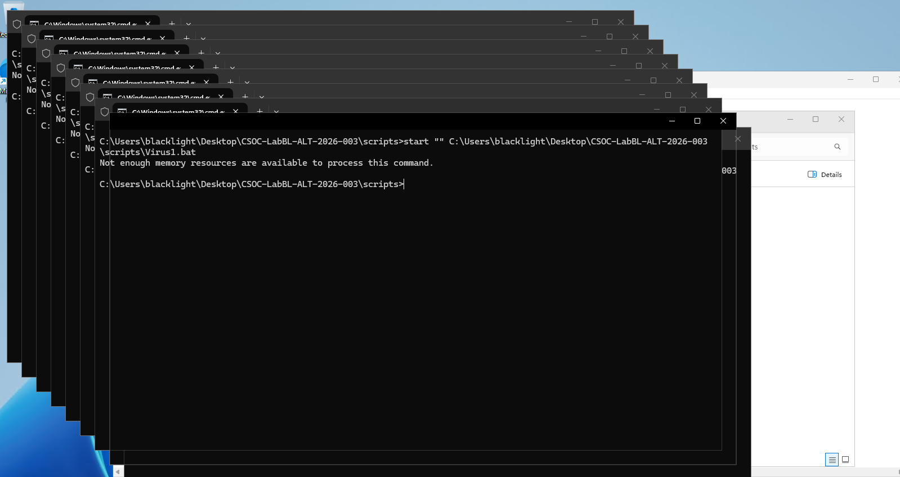
*EV-005 — Controlled script execution producing repeated command-shell processes.*

---

### Are additional users, hosts, or systems involved?

**Answer:** No additional affected users or hosts were observed.

**Evidence:** Scope analysis of the 08:10–08:13 UTC investigation window returned only `vm-win-soc-lab` and `vm-win-soc-lab\blacklight` for the repeated CMD activity.

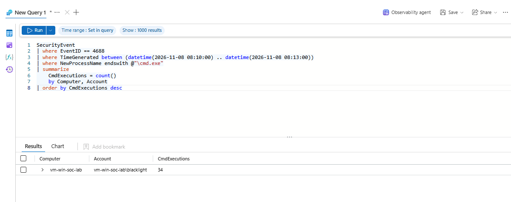
*EV-018 — Scope query showing a single host and account.*

---

### Is there evidence of compromise?

**Answer:** No.

**Evidence:** Process and command-line telemetry correlated the activity directly with the controlled lab path. No unexpected PowerShell, VBScript, additional affected hosts, privilege escalation, persistence, or lateral movement was identified in the investigated window.

---

### Is immediate containment required?

**Answer:** Yes, for the active recursive process loop.

**Reason:** Continued process creation could consume additional endpoint resources. Active `cmd.exe` processes were terminated once the necessary telemetry had been collected.

---

## 6. Indicators & Artifacts

| Type | Value | Reputation / Status | Context |
|---|---|---|---|
| Host | `vm-win-soc-lab` | Known lab asset | Endpoint where simulation occurred |
| User Account | `vm-win-soc-lab\blacklight` | Authorized | Analyst-controlled local account |
| Process | `cmd.exe` | Legitimate Windows binary used in an abnormal pattern | Repeated process creation detected by Sentinel |
| Process | `conhost.exe` | Legitimate Windows component | Console host associated with CMD sessions |
| Parent Process | `explorer.exe` | Legitimate | Launched the initial CMD when the batch file was opened from Explorer |
| Script | `Virus1.bat` | Authorized lab artifact | Source of recursive command-shell activity |
| Windows Event | `4688` | Security telemetry | Process Creation event used for detection and investigation |
| AppLocker Event | `8007` | Mitigation evidence | Confirms that the test script was prevented from running |

---

## 7. Threat Intelligence Enrichment

Not performed. No unknown external IP address, domain, URL, or untrusted executable was involved. All relevant artifacts were known components of the analyst-controlled lab, so reputation lookup would not add meaningful evidence to this case.

---

## 8. Analyst Assessment

### Disposition

- [ ] True Positive — Malicious
- [x] Benign Positive — authorized security testing / successful detection validation
- [ ] False Positive
- [ ] Inconclusive

> The detection logic was correct: the abnormal CMD process burst actually occurred and exceeded the configured threshold. The event is recorded as a benign positive because the activity was deliberately generated by the analyst in an authorized lab. The alert was classified in the portal as **Informational, expected activity — Security testing**.

### Analyst Confidence

- [x] High

### Assessment

**Observed facts:**

- The validation run produced 32 `cmd.exe` executions within one minute.
- The configured detection threshold was 10 executions per minute.
- Investigation of the wider 08:10–08:13 UTC window identified 34 `cmd.exe` executions associated with the `blacklight` account.
- 33 `cmd.exe` processes were spawned by another `cmd.exe` process.
- The initial `cmd.exe` process was launched by `explorer.exe`.
- 34 `conhost.exe` processes were associated with `cmd.exe`, consistent with Windows console behavior.
- Activity was limited to one host and one account.
- No additional suspicious scripting engine or affected endpoint was identified in the investigated window.
- AppLocker later prevented the lab script from running and generated Event ID 8007.
- Post-mitigation validation returned no new `>=10 cmd.exe/minute` burst.

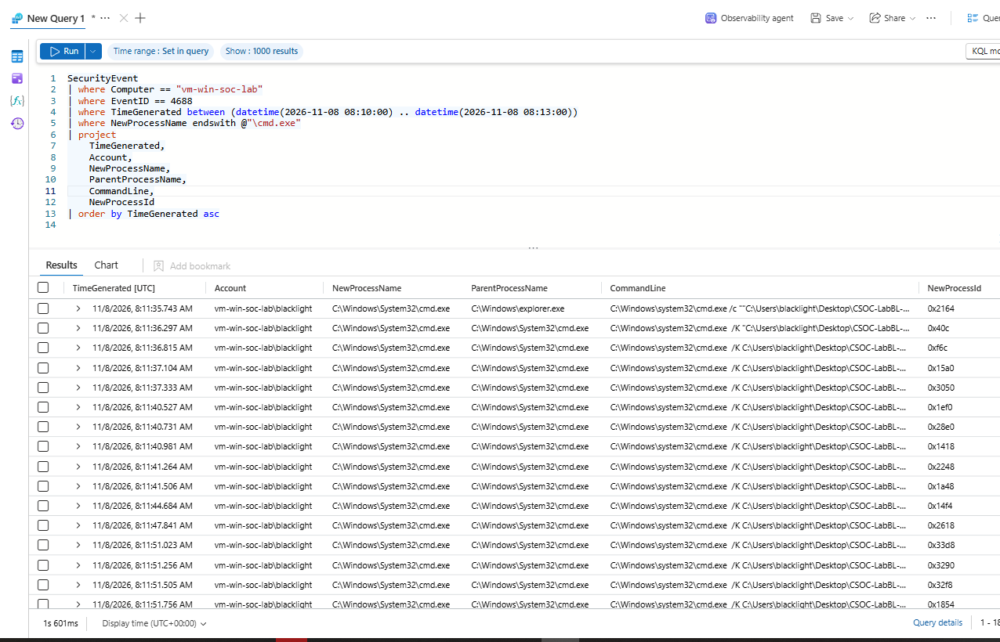
*EV-017 — Event ID 4688 process-chain analysis showing the initial Explorer-launched CMD and subsequent CMD-to-CMD spawning.*

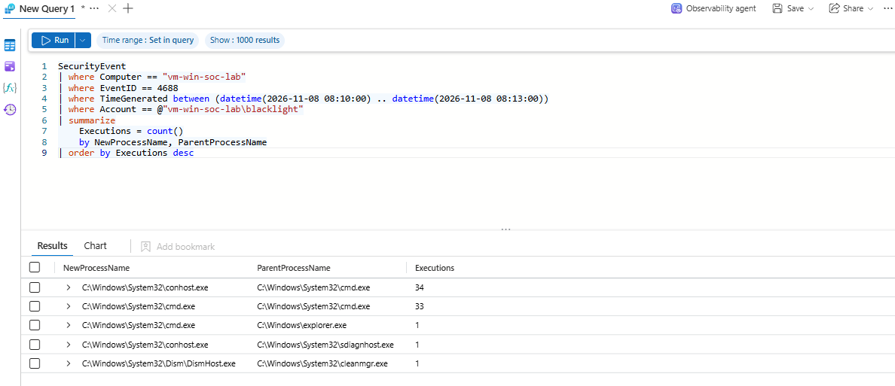
*EV-019 — Process relationship summary showing CMD and Console Host activity.*

**Analyst hypothesis:**

The alert was caused by a recursively executing batch script that repeatedly launched Windows Command Shell instances.

**Conclusion:**

The custom Analytics Rule correctly identified the targeted endpoint behavior. The activity was fully explained by an authorized lab simulation and no evidence of actual compromise was identified.

---

## 9. MITRE ATT&CK Mapping

| Tactic | Technique | Technique ID | Supporting Evidence |
|---|---|---|---|
| Execution | Command and Scripting Interpreter: Windows Command Shell | T1059.003 | Repeated `cmd.exe` process creation and batch-script execution recorded through Event ID 4688 |

> ATT&CK is used here to classify the observed execution behavior. The mapping does not imply that the authorized laboratory script was itself malware.

---

## 10. Scope Assessment

### Confirmed Affected Assets

- `vm-win-soc-lab` — target endpoint of the controlled test; no persistent impact identified.

### Confirmed Account

- `vm-win-soc-lab\blacklight` — analyst-controlled local account.

### Investigation Window

- 2026-11-08 08:10 UTC through 08:13 UTC.

### Process Activity

The wider investigation window contained 34 `cmd.exe` executions. The Analytics Rule reported 32 in the one-minute bin that crossed the threshold. The difference is expected because the alert query grouped activity into one-minute bins while the investigation covered a wider three-minute period.

### Potentially Affected Assets

- None identified.

### Additional Investigation Required

- None for the resolved lab-generated event.
- Future lab work could compare this threshold-based 4688 detection with Sysmon Event ID 1 or an EDR process tree for richer endpoint telemetry.

---

## 11. Recommended Actions

### Immediate

- [x] Preserve evidence
- [x] Terminate active repeated command-shell processes
- [x] Review parent-child process relationships and command lines
- [x] Confirm host and account scope
- [x] Apply a targeted application-control mitigation
- [x] Validate mitigation after enforcement
- [ ] Isolate endpoint from network
- [ ] Disable user account
- [ ] Block external IP / domain / hash

### Containment

PowerShell was used to count and terminate active `cmd.exe` processes:

```text
(Get-Process cmd -ErrorAction SilentlyContinue).Count
Get-Process cmd -ErrorAction SilentlyContinue | Stop-Process -Force
(Get-Process cmd -ErrorAction SilentlyContinue).Count
```

The observed count dropped from 7 active CMD processes to 0.

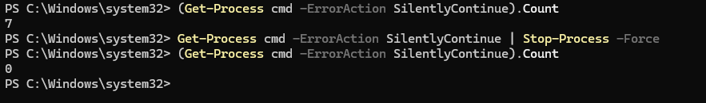
*EV-020 — Active CMD processes reduced from 7 to 0.*

### Mitigation

AppLocker was configured using the Script Rules collection. Default rules were created first to establish a safe baseline, then a targeted Deny rule was created for the controlled lab script using a File Hash condition.

```text
Rule name: Deny Virus1.bat - Lab Simulation
Action: Deny
User: Everyone
Condition: File Hash
```

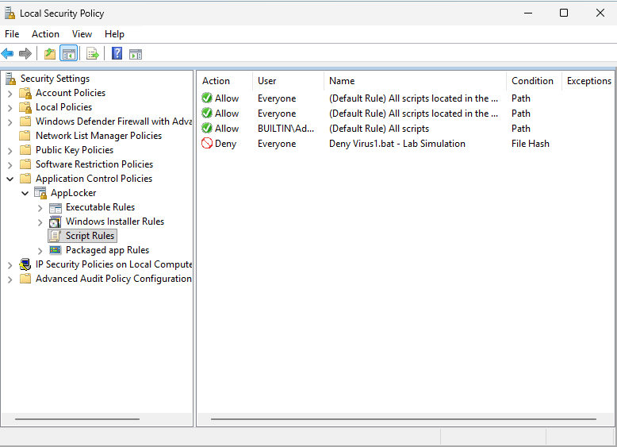
*EV-022 — Targeted AppLocker File Hash Deny rule.*

Script-rule enforcement was enabled and the Application Identity service (`AppIDSvc`) was started and verified as running.

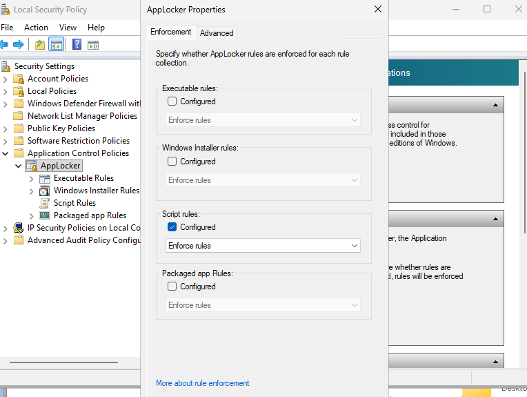
*EV-023 — Script Rules configured in Enforce mode.*

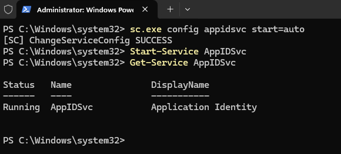
*EV-024 — Application Identity service running.*

---

## 12. Mitigation Validation

After AppLocker enforcement was applied, the controlled batch file was executed again. Windows logged AppLocker Event ID 8007 and explicitly reported that `Virus1.bat` was prevented from running.

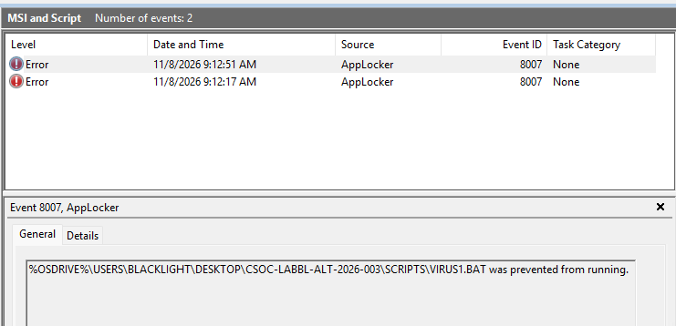
*EV-025 — AppLocker Event ID 8007 confirming the test script was prevented from running.*

A final Sentinel query checked for any new period after mitigation containing 10 or more `cmd.exe` executions per minute:

```text
SecurityEvent
| where Computer == "vm-win-soc-lab"
| where EventID == 4688
| where TimeGenerated >= datetime(2026-11-08 09:12:00)
| where NewProcessName endswith @"\cmd.exe"
| summarize CmdExecutions = count()
    by Computer, Account, bin(TimeGenerated, 1m)
| where CmdExecutions >= 10
```

The query returned no results.

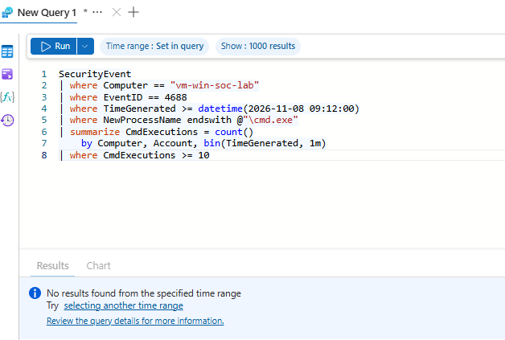
*EV-026 — No post-mitigation CMD burst met the detection threshold.*

This validates the intended lab outcome: the specific script was blocked and the previously observed process burst did not recur.

---

## 13. Escalation Decision

| Field | Value |
|---|---|
| **Escalation Required** | No |
| **Reason** | Authorized security testing; activity fully explained and no evidence of compromise or additional affected assets identified |

---

## 14. Analyst Notes

```text
Analyst notes:

- Process Creation auditing and command-line auditing were enabled before the test so that
  Windows Security Event ID 4688 could provide useful endpoint telemetry.

- A controlled notepad.exe launch confirmed that Event ID 4688 was generated locally and
  successfully ingested into Microsoft Sentinel before the simulation began.

- The first script run produced significantly higher CMD activity than the observed baseline,
  including peaks of 48 and 23 cmd.exe executions per minute.

- Based on the observed lab behavior, an initial threshold of 10 cmd.exe executions per minute
  was selected. This value is specific to the training environment and should not be treated
  as a universal production threshold.

- The scheduled Analytics Rule was mapped to MITRE ATT&CK T1059.003 (Windows Command Shell),
  with Host and Account entities mapped from the KQL results.

- During rule validation, the controlled script generated 32 cmd.exe executions within one
  minute and successfully triggered the scheduled detection.

- The alert did not appear immediately. Ingestion-delay troubleshooting showed that the
  relevant SecurityEvent records reached Log Analytics roughly 23–36 seconds after their
  TimeGenerated values. The scheduled rule subsequently generated the expected alert and
  incident.

- Investigation of the wider event window identified 34 cmd.exe executions. The difference
  between 32 and 34 is expected because the rule grouped events into one-minute bins while the
  investigation covered a wider three-minute window.

- Parent/child analysis showed explorer.exe launching the initial cmd.exe, consistent with the
  analyst opening the batch file from Windows Explorer. Subsequent command shells were
  predominantly spawned by cmd.exe itself.

- conhost.exe activity correlated with the command-shell processes and was assessed as expected
  Windows Console Host behavior.

- Active command-shell processes were manually terminated as the containment action.

- AppLocker was selected as the mitigation control. A File Hash Deny rule targeted the specific
  lab artifact without broadly blocking all batch scripts or the full lab directory.

- AppLocker Event ID 8007 confirmed the script was prevented from running after enforcement.

- Post-mitigation Sentinel validation found no new >=10 cmd.exe-per-minute burst.

- Additional controlled validation activity was grouped into the existing incident because the
  Analytics Rule was configured to group alerts when all mapped entities matched within a
  five-hour window. The final incident view contained three alerts.

- The alert was resolved as Informational, expected activity -> Security testing. The final
  incident view showed the case as Resolved / Benign Positive.

- This case demonstrates detection engineering, endpoint triage, containment and mitigation
  validation rather than response to an actual compromise.
```

---

## 15. Closure

| Field | Value |
|---|---|
| **Final Status** | Resolved |
| **Final Portal Disposition** | Benign Positive |
| **Alert Classification** | Informational, expected activity — Security testing |
| **Closure Date** | 2026-11-08 |
| **Resolution** | Detection validated; active processes contained; targeted AppLocker mitigation implemented and successfully validated |

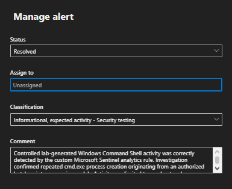
*EV-027 — Alert resolved as Informational, expected activity — Security testing.*

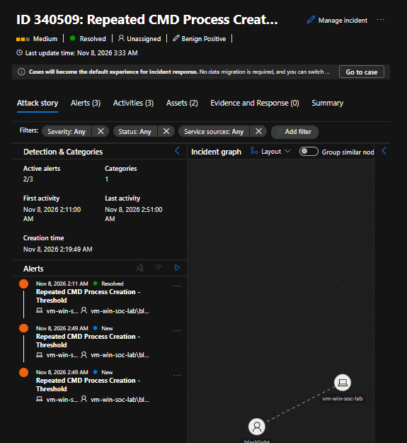
*EV-028 — Final incident view showing incident `340509` as Resolved / Benign Positive.*

### Closure Summary

A controlled Windows batch-script simulation generated abnormal repeated `cmd.exe` process creation on `vm-win-soc-lab`. Windows Security Event ID 4688 telemetry was collected through Azure Monitor Agent and investigated in Microsoft Sentinel.

A custom scheduled Analytics Rule detected 32 CMD executions within one minute and generated incident `340509`. Process-chain analysis confirmed an initial `explorer.exe → cmd.exe` relationship followed by repeated `cmd.exe → cmd.exe` spawning. The activity was limited to one host and the analyst-controlled `blacklight` account, with no evidence of persistence, privilege escalation, lateral movement, or an actual compromise.

Active command shells were terminated as containment. A File Hash AppLocker Deny rule was then applied to the controlled script, with enforcement enabled and Application Identity running. Event ID 8007 confirmed the script was prevented from running, and a post-mitigation Sentinel query found no new command-shell burst above the detection threshold.

The alert was classified as expected security testing and the incident was resolved as a benign positive.

---

## 16. Evidence References

| Evidence ID | Description | Location |
|---|---|---|
| EV-001 | Process Creation auditing enabled | `evidence/01_process_audit_enabled.png` |
| EV-002 | Command-line data enabled in Process Creation events | `evidence/02_command_line_audit_enabled.png` |
| EV-003 | Local Event ID 4688 showing `cmd.exe → notepad.exe` | `evidence/03_event_4688_local.png` |
| EV-004 | Event ID 4688 successfully ingested into Sentinel | `evidence/04_sentinel_4688_ingestion.png` |
| EV-005 | Controlled repeated CMD execution | `evidence/05_cmd_loop_execution.png` |
| EV-006 | Raw CMD Event ID 4688 records in Sentinel | `evidence/06_attack_raw_events.png` |
| EV-007 | Baseline and CMD execution-rate analysis | `evidence/07_cmd_execution_rate_analysis.png` |
| EV-008 | KQL threshold detection | `evidence/08_kql_cmd_detection.png` |
| EV-009 | Analytics Rule general configuration and MITRE mapping | `evidence/09_analytics_rule_general.png` |
| EV-010 | Analytics Rule KQL and entity mapping | `evidence/10a_rule_query_and_entities.png` |
| EV-011 | Custom details and rule schedule | `evidence/10b_rule_schedule_and_custom_details.png` |
| EV-012 | Incident creation and alert grouping settings | `evidence/11_incident_grouping_settings.png` |
| EV-013 | Analytics Rule review and validation | `evidence/12_analytics_rule_review.png` |
| EV-014 | Second simulation / 32-execution detection validation | `evidence/13a_second_detection_validation.png` |
| EV-015 | Sentinel incident `340509` overview | `evidence/14_sentinel_incident_overview.png` |
| EV-016 | Alert details showing `CmdExecutions = 32` | `evidence/15_alert_details.png` |
| EV-017 | Process-chain investigation | `evidence/16_process_chain_investigation.png` |
| EV-018 | Scope assessment: one host and one account | `evidence/17_scope_assessment.png` |
| EV-019 | Related process / parent process analysis | `evidence/18_related_process_analysis.png` |
| EV-020 | Process containment: 7 CMD processes reduced to 0 | `evidence/19_process_containment.png` |
| EV-021 | AppLocker default Script Rules | `evidence/20_applocker_default_script_rules.png` |
| EV-022 | AppLocker File Hash Deny rule | `evidence/21_applocker_deny_hash_rule.png` |
| EV-023 | AppLocker Script Rules enforcement enabled | `evidence/22_applocker_enforcement_enabled.png` |
| EV-024 | Application Identity service running | `evidence/23_application_identity_running.png` |
| EV-025 | AppLocker Event ID 8007 blocking the script | `evidence/25_applocker_block_event.png` |
| EV-026 | Post-mitigation validation: no threshold violations | `evidence/26_post_mitigation_validation.png` |
| EV-027 | Alert resolved as expected security testing | `evidence/27_alert_resolution.png` |
| EV-028 | Final incident view: Resolved / Benign Positive | `evidence/28_incident_resolved.png` |

---

# Document Control

| Field | Value |
|---|---|
| **Framework** | Blacklight Incident Response Framework |
| **Template** | SOC Alert Triage |
| **Version** | 1.0 |
| **Environment** | Cybersecurity Training / Portfolio Lab |
| **Classification** | Public |
